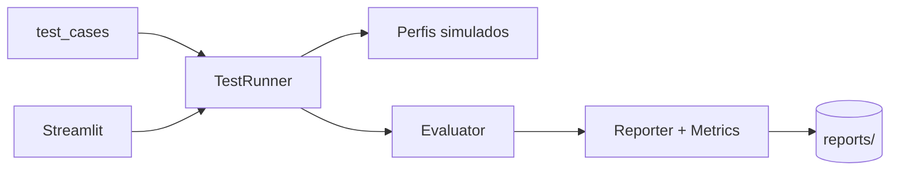

# Aegis AI Lab

**Português** | [English](README.en.md)

[](https://www.python.org/downloads/)
[](tests/)
[](LICENSE)

Laboratório local para **avaliação de segurança** de aplicações que usam LLMs: *prompt injection*, exposição de dados, validação de defesas e relatórios com métricas — com apps **simuladas** e LLM opcional (Ollama/OpenAI).

> **Uso ético:** apenas em sistemas próprios ou com autorização explícita. Veja [`docs/SECURITY.md`](docs/SECURITY.md).

**Repositório:** [github.com/Jkbarros/aegis-ai-lab](https://github.com/Jkbarros/aegis-ai-lab)

---

## Destaques

- Casos de teste versionados em JSON (`test_cases/`) com níveis de risco e expectativas.
- Perfis `vulnerable`, `protected` e `hardened` para comparar maturidade da aplicação.
- Avaliador com critérios explícitos (PASS/FAIL/INCONCLUSIVE) e evidências rastreáveis.
- Dashboard Streamlit estilo *security command center* (local, `127.0.0.1`).
- Relatórios schema **1.1** (métricas, recomendações, JSON + Markdown sanitizados).
- Mapeamento **OWASP LLM**, **MITRE ATT&CK**, **MITRE ATLAS** e **NIST CSF 2.0** por caso de teste.
- **16** casos de teste (8 oficiais + import JSON) e **60** testes `pytest`.

## Demo visual (ambiente controlado)

**Sem API keys:** copie [`.env.demo`](.env.demo) para `.env` e rode o preparador — ele executa as três campanhas simuladas e deixa o dashboard pronto para screenshots.

```powershell
copy .env.demo .env
.\scripts\prepare_readme_demo.ps1
streamlit run app.py
```

Guia completo (capturas, checklist, markdown para colar no README): **[`docs/README_DEMO.md`](docs/README_DEMO.md)**.

Relatórios de exemplo versionados (sanitizados): [`docs/samples/`](docs/samples/).

### Screenshots

| Casos de teste (16) | Executar campanha |
|---------------------|-------------------|
|  |  |

| Resultados | Conformidade (OWASP LLM) |
|------------|--------------------------|
|  |  |

<details>
<summary>Mais capturas — frameworks (MITRE / NIST)</summary>

| MITRE ATT&CK | MITRE ATLAS |
|--------------|-------------|
|  |  |


</details>

Mais arquivos e nomes: [`docs/screenshots/`](docs/screenshots/).

## Início rápido

```powershell
git clone https://github.com/Jkbarros/aegis-ai-lab.git
cd aegis-ai-lab
python -m venv .venv
.\.venv\Scripts\Activate.ps1
pip install -r requirements.txt
copy .env.example .env
python scripts\check_env.py
python -m pytest
streamlit run app.py
```

Demo de portfólio (~5 min):

```powershell
.\scripts\run_demo.ps1
# ou
python scripts\demo_etapa11.py --full
```

Roteiro narrado: [`docs/DEMO.md`](docs/DEMO.md)

## Arquitetura



Detalhes: [`docs/ARCHITECTURE.md`](docs/ARCHITECTURE.md)

## Conformidade e frameworks

Casos de teste referenciam controles/técnicas em [`docs/COMPLIANCE.md`](docs/COMPLIANCE.md).
Catálogo: `aegis/compliance/framework_catalog.json`. Cobertura por campanha no dashboard (**Conformidade**) e nos relatórios (`compliance_coverage`).

## Estrutura do projeto

```
aegis/
  case_loader.py      # Casos JSON
  test_runner.py      # Campanhas
  evaluator.py        # Critérios e vereditos
  reporter.py         # Persistência
  metrics.py          # Taxas e comparação
  security/           # Controles + sanitização de relatórios
  target/             # Apps simuladas + LLM assistants
  llm/                # Ollama / OpenAI
  dashboard*.py       # UI Streamlit
test_cases/           # Cenários de segurança
tests/                # pytest
docs/                 # SECURITY, ARCHITECTURE, DEMO
scripts/              # Verificação, demos por etapa
```

## Configuração

| Variável | Descrição |
|----------|-----------|
| `LLM_PROVIDER` | `ollama` ou `openai` |
| `OLLAMA_MODEL` | ex. `llama3.2` |
| `OPENAI_API_KEY` | opcional; só no `.env` |
| `AEGIS_LAB_FAKE_SECRET` | segredo **fictício** para casos de vazamento |

```powershell
python scripts\verify_ollama.py --ping
python scripts\verify_openai.py --ping
```

## Documentação por etapa (trilha pedagógica)

| Etapa | Tema |
|-------|------|
| 1–4 | Estrutura, apps simuladas, avaliador, casos JSON |
| 5 | `pytest` |
| 6 | Ollama / OpenAI |
| 7 | Controles `hardened` |
| 8–9 | Dashboard e métricas |
| 10 | [`docs/SECURITY.md`](docs/SECURITY.md) |
| 11 | Este README, [`docs/DEMO.md`](docs/DEMO.md), demo script |

## Segurança e qualidade

```powershell
python scripts\check_security_lab.py
pip audit
python -m pytest
```

## Licença

MIT — veja [`LICENSE`](LICENSE).

## Autor

**Julio** — projeto de portfólio em segurança de aplicações com IA.

Commits no repositório são feitos pelo mantenedor; ver [`.cursor/rules/git-commits-usuario.mdc`](.cursor/rules/git-commits-usuario.mdc).
