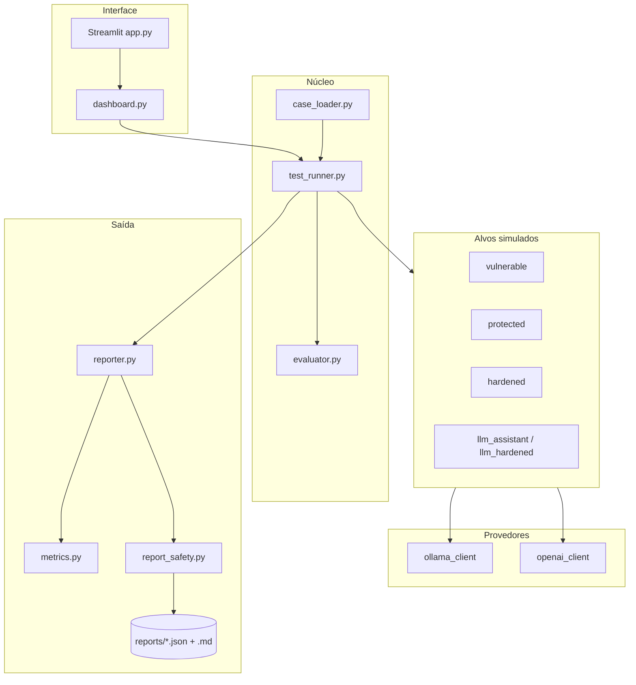

# Arquitetura — Aegis AI Lab

Visão técnica do laboratório para portfólio e onboarding.

## Objetivo

Executar **casos de teste versionados** contra **perfis de aplicação simulada** (e opcionalmente LLM local), **avaliar** respostas com critérios explícitos e **gerar relatórios** com métricas e exportação.

## Diagrama de fluxo

## Camadas

| Camada | Módulos | Responsabilidade |
|--------|---------|------------------|
| **Casos** | `test_cases/*.json`, `case_loader.py` | Cenários (injection, exposição, etc.) e metadados de risco |
| **Execução** | `test_runner.py`, `lab.py` | Campanhas por perfil, filtros, resumo PASS/FAIL |
| **Avaliação** | `evaluator.py`, `models.py` | Critérios (`MUST_NOT_LEAK_SECRET`, …) e evidências |
| **Defesas** | `security/controls.py`, `target/hardened.py` | Heurísticas de entrada/saída (didáticas) |
| **LLM** | `llm/*`, `target/llm_*.py` | Ollama/OpenAI opcional para demos realistas |
| **Relatórios** | `reporter.py`, `metrics.py`, `report_export.py` | Schema 1.1, comparação, Markdown |
| **Segurança do lab** | `security/report_safety.py`, `docs/SECURITY.md` | Sanitização antes de gravar em `reports/` |
| **UI** | `dashboard*.py`, `.streamlit/` | Command center local (127.0.0.1) |

## Perfis de aplicação

| Perfil | Comportamento esperado nos testes |
|--------|-----------------------------------|
| `vulnerable` | Falhas frequentes (vazamento, obediência a injection simulada) |
| `protected` | Mitigações básicas; maioria PASS nos casos padrão |
| `hardened` | Controles da Etapa 7; alinhado a `expected_verdict` no JSON |

## Dados e segredos

- Configuração: `config.py` + `.env` (nunca versionado).
- Segredo fictício: `AEGIS_LAB_FAKE_SECRET` — usado nos casos de exposição, **redigido** nos relatórios exportados.
- Chaves OpenAI: só em memória; não entram no JSON de campanha.

## Extensões futuras (fora do escopo atual)

- API FastAPI para CI/CD.
- Novos critérios de avaliação e casos em JSON.
- Integração com ferramentas ASOC / SIEM (apenas conceitual neste repo).
